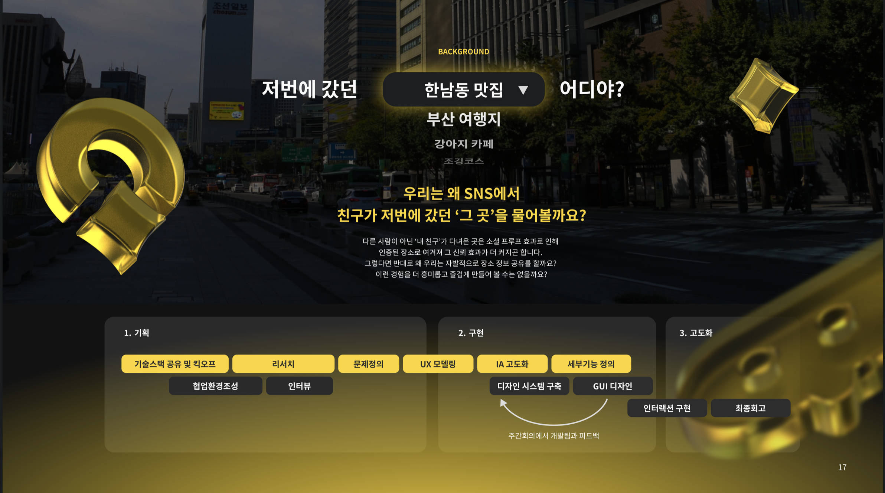
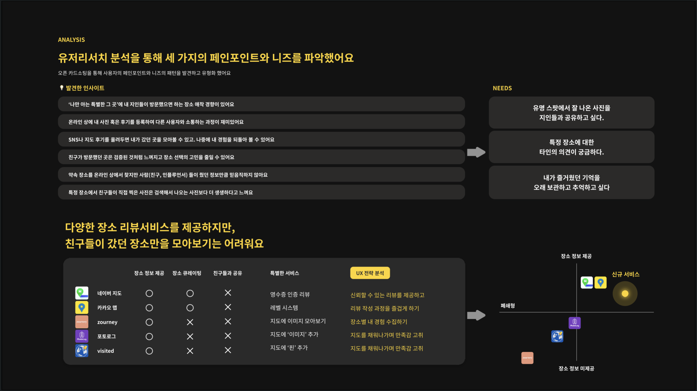
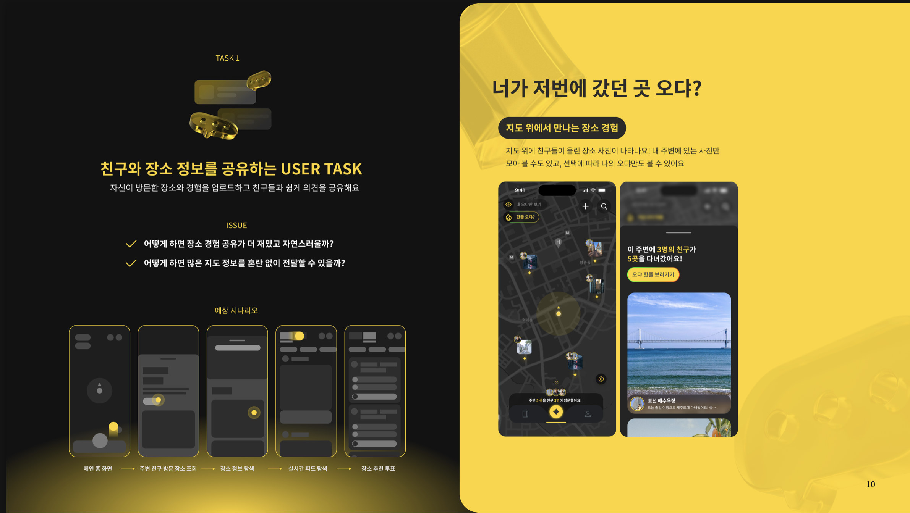
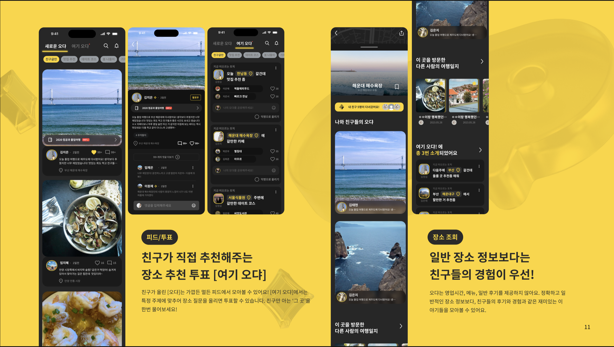
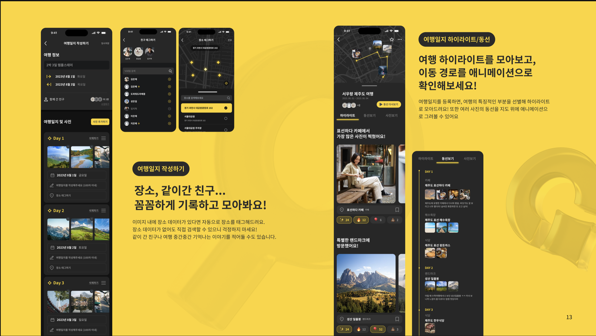
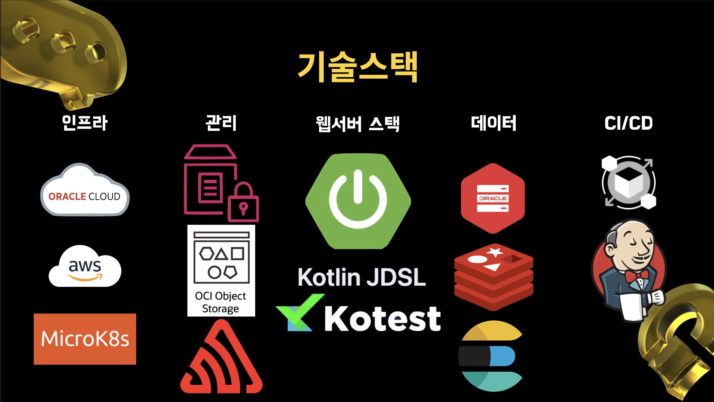
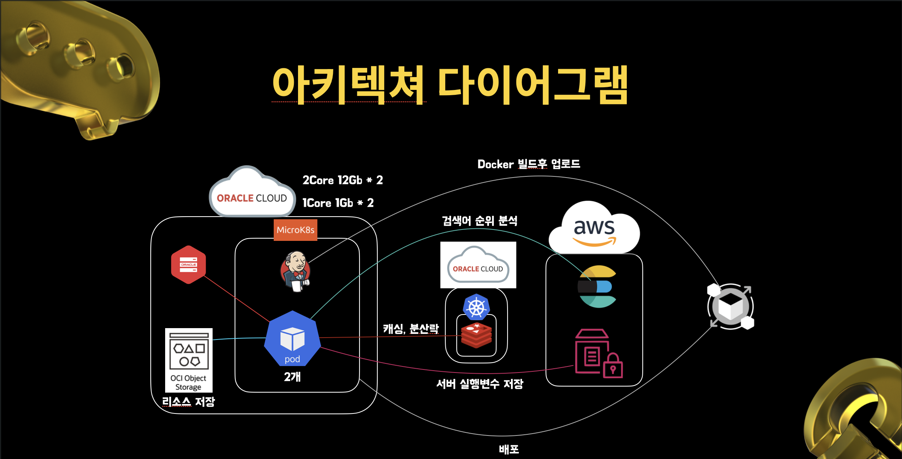

# Odya (오댜) - Backend Server

> **"너가 저번에 갔던 곳 오댜?"**
>
> 친구들과 장소 경험을 공유하고, 지도 위에서 소중한 추억을 기록하는 소셜 여행 서비스



---

## 프로젝트 소개

**Odya(오댜)** 는 "나만 아는 그 곳"을 친구들과 공유하고, 신뢰할 수 있는 지인의 경험을 바탕으로 장소를 탐색할 수 있는 서비스입니다.

### 왜 Odya인가?

기존의 장소 리뷰 서비스들은 많지만, **친구들이 갔던 장소만을 모아보기는 어렵습니다.**

- 온라인상에서 가볼만한 장소를 탐색할 때, 인플루언서나 광고성 리뷰보다 **친구들의 경험을 더 신뢰**합니다
- 특정 장소에서 친구들이 직접 찍은 사진은 검색해서 나오는 사진보다 **더 생생하다**고 느낍니다
- SNS나 지도 후기를 올려두면 내가 갔던 곳을 모아볼 수 있고, **나중에 내 경험을 되돌아 볼 수 있습니다**



---

## 주요 기능

### 1. 지도 위에서 만나는 장소 경험
지도 위에 친구들이 올린 장소 사진이 나타납니다. 내 주변에 있는 사진만 모아 볼 수도 있고, 선택에 따라 나의 오댜만도 볼 수 있어요.



### 2. 피드 & 장소 추천 투표
- **피드**: 친구가 직접 추천해주는 장소 추천 투표 "여기 오댜"
- **장소 조회**: 일반 장소 정보보다 친구들의 경험이 우선!



### 3. 여행일지 작성 및 하이라이트
- 장소, 같이 간 친구 등을 꼼꼼하게 기록하고 모아볼 수 있습니다
- 여행 하이라이트를 모아보고, 이동 경로를 애니메이션으로 확인할 수 있습니다



---

## 기술 스택



### Backend
| 분류        | 기술                              |
|-----------|---------------------------------|
| Language  | Kotlin                          |
| Framework | Spring Boot 3.1.6               |
| ORM       | Spring Data JPA, Kotlin JDSL    |
| Test      | Kotest, MockK, Spring REST Docs |
| Build     | Gradle (Kotlin DSL)             |

### Database & Storage
| 분류             | 기술                 |
|----------------|--------------------|
| RDBMS          | Oracle Database    |
| Cache          | Redis (Redisson)   |
| Search Engine  | OpenSearch         |
| Object Storage | OCI Object Storage |

### Infrastructure
| 분류                      | 기술                    |
|-------------------------|-----------------------|
| Cloud                   | Oracle Cloud, AWS     |
| Container Orchestration | MicroK8s (Kubernetes) |
| CI/CD                   | Jenkins               |
| Monitoring              | Sentry                |

### External Services
| 분류                | 기술                       |
|-------------------|--------------------------|
| Push Notification | Firebase Cloud Messaging |
| Map API           | Google Maps, Kakao Map   |
| Authentication    | Kakao OAuth              |

---

## 시스템 아키텍처



### 주요 구성요소
- **MicroK8s**: Oracle Cloud 위에서 2개의 Pod로 애플리케이션 운영
- **OCI Object Storage**: 이미지 등 리소스 저장
- **Redis**: 캐싱 및 분산락 처리
- **OpenSearch**: 검색어 순위 분석
- **AWS Parameter Store**: 서버 실행 변수 저장
- **Jenkins**: Docker 빌드 후 배포 자동화

---

## 프로젝트 구조

```
src/main/kotlin/kr/weit/odya/
├── client/          # 외부 API 클라이언트 (Google Maps, Kakao, FCM)
├── config/          # Spring 설정 클래스
├── controller/      # REST API 컨트롤러
├── domain/          # JPA 엔티티 및 레포지토리
├── listener/        # 이벤트 리스너
├── security/        # 인증/인가 관련
├── service/         # 비즈니스 로직
├── support/         # 공통 지원 클래스
└── util/            # 유틸리티 클래스
```

### 주요 도메인
- **User**: 사용자 관리, 프로필, 팔로우
- **TravelJournal**: 여행일지 작성 및 관리
- **Community**: 커뮤니티 피드, 좋아요, 댓글
- **PlaceReview**: 장소 리뷰
- **FavoritePlace**: 관심 장소 저장

---

## 시작하기

### 요구사항
- JDK 17+
- Gradle 8.x
- Oracle Database
- Redis

### 빌드 및 실행

```bash
# 프로젝트 빌드
./gradlew build

# 테스트 실행
./gradlew test

# 애플리케이션 실행
./gradlew bootRun
```

### API 문서
애플리케이션 실행 후 `/docs/index.html`에서 Spring REST Docs로 생성된 API 문서를 확인할 수 있습니다.
